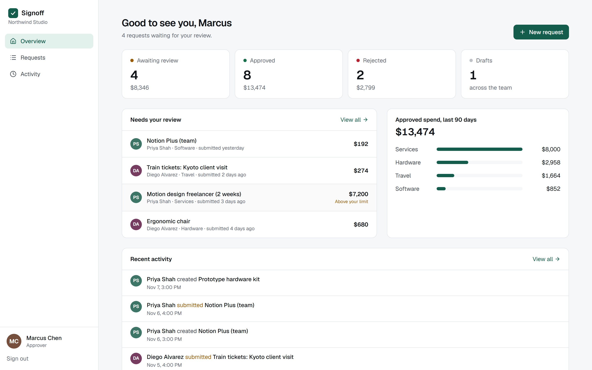
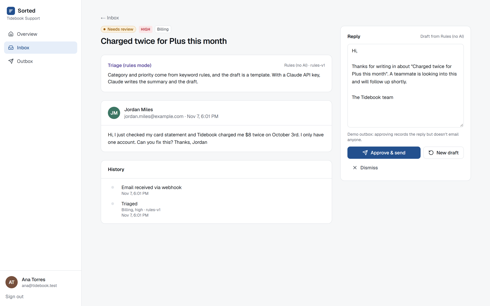
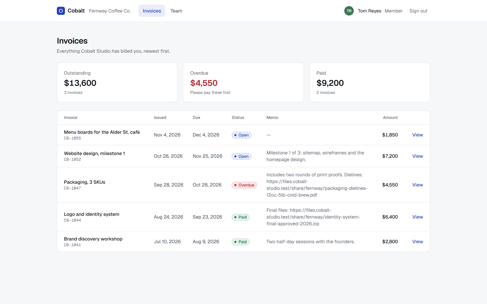

# Next.js + Supabase portfolio: three working apps with tests

Three small but complete personal projects, each built around a problem clients bring to Next.js + Supabase developers. Each comes with the tests and evidence behind its claims.

| | Project | What it shows | Evidence |
| --- | --- | --- | --- |
| ① | [**Signoff**](apps/signoff) — multi-tenant approval workflow | Roles and approval limits enforced in Postgres (RLS + functions), an append-only log of status and role changes, a race between two approvers, a phone layout | 18 unit, 28 DB, 12 browser tests, 10 deliberate weaknesses each caught |
| ② | [**Sorted**](apps/sorted) — AI support inbox with human approval | A signed webhook, a Postgres job queue with retries, Claude structured output, prompt-injection handling, a person approves every reply | 33 unit, 19 DB, 11 browser tests, 13 deliberate weaknesses each caught |
| ③ | [**Cobalt**](apps/rescue) — production rescue case study | Three bug reports (random sign-outs, one client reading another's invoices, a broken phone layout), and two more found in review (self-promotion to owner, a redirect to another site after sign-in), each reproduced, fixed and proven with the same tests | Each of the 5 bugs has a test that fails on the shipped code and passes on the fix; every other failure is explained |

| ① Signoff | ② Sorted | ③ Cobalt (after the fix) |
| --- | --- | --- |
|  |  |  |

## How these were checked

- Test results in each README are from runs on this machine (Windows 11, last full run Nov 7, 2026), with the command to repeat them. Nothing is marked as passing that wasn't run.
- For the database tests, I broke the security rules on purpose, one at a time, and confirmed the suite fails each time (`node scripts/mutations.mjs <app>`; the logs are in each app's evidence folder). A suite that can't fail proves nothing. Tests of a race run it 5 to 20 times, because a race that is lost once in five tries would slip through a single run.
- The local stack grants tables to `anon` and `authenticated` the way a hosted Supabase project does, so the tests prove that row-level security, not a missing grant, keeps data private.
- Every app went through repeated code reviews by separate Claude sessions, scored against a written rubric. Every finding is fixed, and each code bug has a test that fails without the fix.
- The login page and every main screen of the three apps were loaded at 320, 375, 390, 768 and 1440 px wide: 85 page loads, and none scrolls sideways. The first run found three that did (two grids that wouldn't shrink below their content); they were fixed and re-checked.
- Lighthouse 12.8 on the production builds, the login page and one main signed-in page per app (Signoff `/dashboard`, Sorted `/inbox`, Cobalt `/invoices`), mobile and desktop: accessibility 100 and best practices 100 in all 12 runs, performance 94–100 in the latest run (94–99 on the mobile profile, 100 on desktop). Performance moves with load on this laptop: a run on Nov 4 gave the Signoff dashboard 90 on the mobile profile. SEO is 100 on the signed-in pages and 91 on the login pages, because these private apps send every unknown path, `/robots.txt` included, to the login page. These were measured on localhost, so they say the pages are light and well built, not how fast a hosted deployment would be.
- Screenshots come from production builds (`next build && next start`) with the seed data. None are mock-ups or generated images.

## Shared local stack (`devstack/`)

All three apps run against Postgres 16 and PostgREST 12, without Docker. `devstack/` adds a small gateway that speaks the part of the Supabase Auth API the apps use: password sign-in, refresh with GoTrue's 10-second reuse window, user and sign-out. The gateway also proxies `/rest/v1`. The same migrations and seeds apply unchanged to a hosted Supabase project.

```bash
npm install                      # at the repository root (npm workspaces)
# devstack/local.env (not committed): POSTGREST_BIN=..., PG_BIN=... (Postgres bin directory)
cd apps/<app>
npm run db:reset                 # schema + seed, writes .env.local with local-only keys
npm run stack                    # PostgREST + auth gateway, leave running
npm run dev
```

On Windows, PostgREST never received Postgres `NOTIFY`, so `notify pgrst` didn't reload its schema cache after a reset. The OpenAPI root is generated live, so it looked fresh when it wasn't. `npm run stack` therefore watches for resets and restarts PostgREST. The reset then waits until a function created with that reset is callable through the API, so tests never run against a stale cache.

## Repository layout

```
apps/signoff   ① approval workflow
apps/sorted    ② AI support inbox
apps/rescue    ③ rescue case study (case/ holds the shipped code, the evidence and the screenshots)
devstack/      local Supabase-compatible stack shared by all three
```
