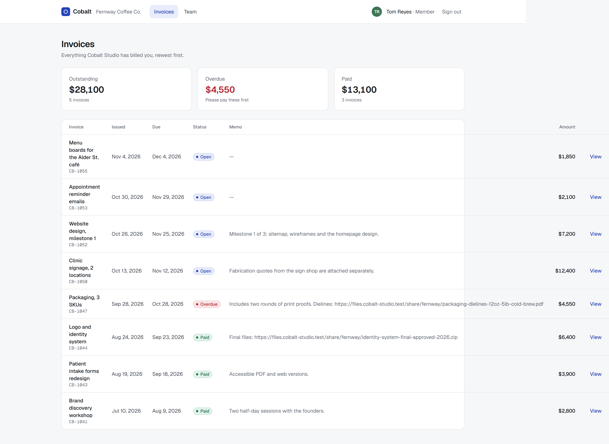
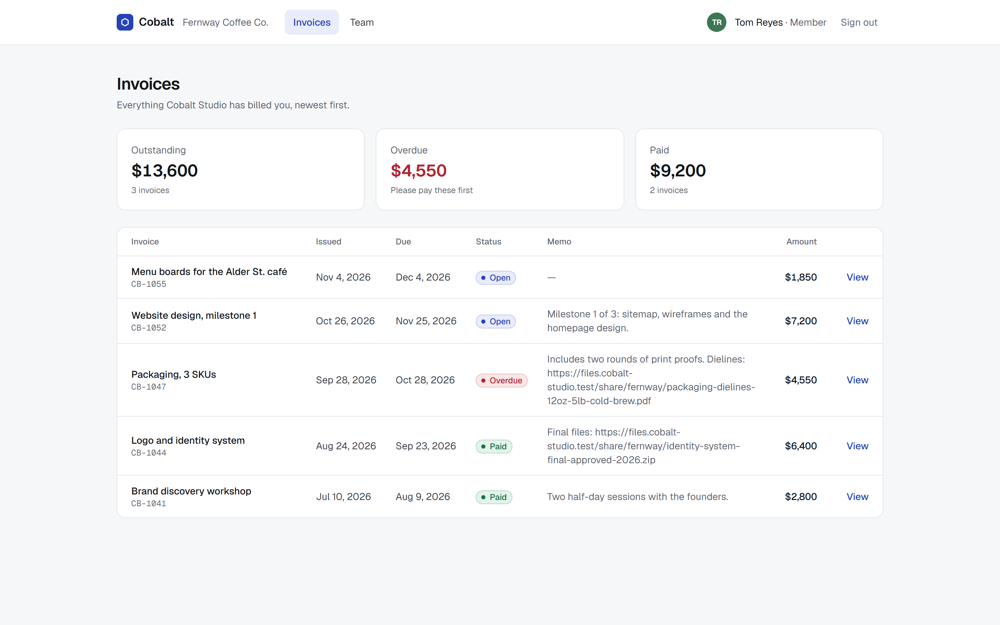
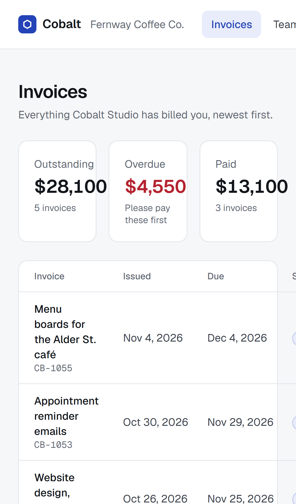
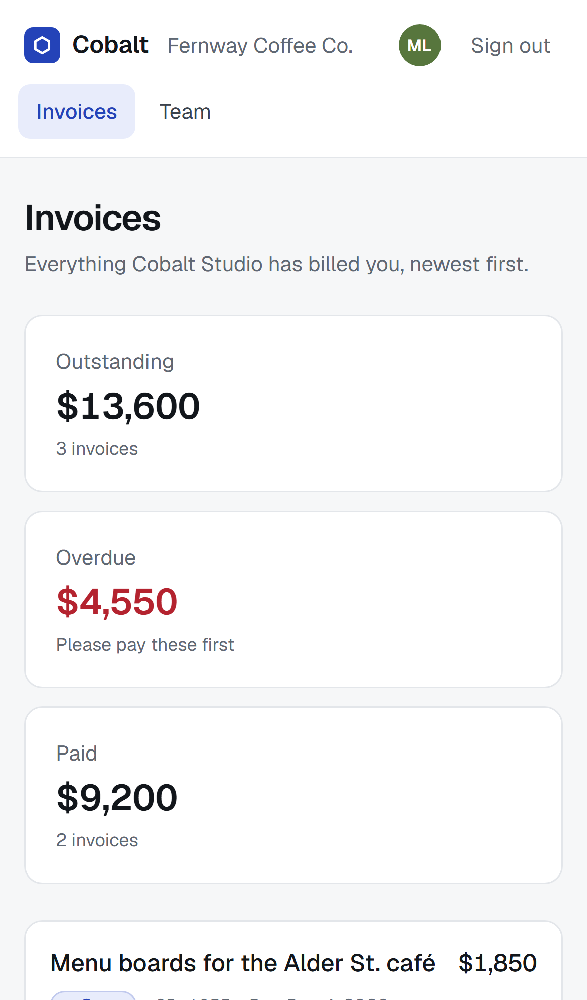

# Cobalt — a production rescue case study (Next.js + Supabase)

Three bug reports on a client portal (plus a fourth bug found while auditing it, and a fifth that a later code review found and my audit had missed), each reproduced with a failing test, fixed, and proven fixed by the same test:

1. "I keep getting signed out."
2. "I can see another company's invoices."
3. "On my phone the invoice page is cut off and I can't sign out."

**This is a constructed exercise, not a client project.** I built Cobalt — a small portal where a design studio's clients see their invoices and manage their team — and shipped it with three bugs that are common in quickly built Next.js + Supabase apps. I planted those three and the fourth on purpose. The fifth I didn't plant: it was a real mistake in my own code, which my audit missed and a later review found. Then I fixed it all the way I'd fix a client's app. All data is fictional.

| Before | After |
| --- | --- |
|  |  |
|  |  |

## The three reports

### 1. Signed out after the access token expires

**Symptom.** About an hour after signing in, the next click or the one after it lands on the login page.

**Cause.** The route guard (`proxy.ts`, Next 16's middleware) only checked that a Supabase cookie *existed*. Nothing refreshed the session in a place that can save cookies. Once the access token expired, each page refreshed it on its own, but Server Components can read cookies, not write them, so the new tokens were thrown away. The next request sent a refresh token that had already been used, the auth server rejected it, and the user was signed out.

**Fix.** The proxy now creates a Supabase server client, calls `getUser()` (which validates the token and refreshes it when needed), and writes the new cookies to both the request the page sees and the response the browser keeps. [`proxy.ts`](proxy.ts)

**Proof.** `stays signed in after the access token expires` signs in, waits past expiry, then loads two pages 12 seconds apart. The gap matters: Supabase accepts a used refresh token again for 10 seconds, so loads closer together hide the bug. To keep the test at two minutes, the local stack issues 100-second tokens instead of 1-hour ones. It can't go lower: supabase-js starts refreshing 90 seconds before expiry, and anything shorter makes every new token already due for refresh, which is a different, test-only failure.

### 2. Every client could read every other client's invoices

**Symptom.** Tom from Fernway Coffee saw Lumen Dental's invoices in his list, and could open them by URL. The page even said "Billed to Fernway Coffee Co.", because the page took the client name from Tom's session.

**Cause.** The pages rely on row-level security (RLS) instead of filtering by client in every query, which is the right design. But the policy was `using (auth.uid() is not null)`: any signed-in user, any invoice.

**Fix.** A new migration, the way it would reach a live database, replaces the policy with `using (public.is_member(client_id))`. [`0003_fix_tenant_access.sql`](supabase/migrations/0003_fix_tenant_access.sql). The shipped [`0002_policies.sql`](supabase/migrations/0002_policies.sql) is left as it was.

**Proof.** Database tests read invoices as each user through the real API, and ask for another client's invoice by id. Browser tests check the list and the direct URL.

### 3. The phone layout

**Symptom.** On a 390 px phone the page scrolled sideways, the invoice table ran off the screen, the "View" links were out of reach, and so was **Sign out**.

**Cause.** A one-row header with `whitespace-nowrap`, a three-column stat grid at every width, a table with a fixed `min-width`, and memos that contained long unbroken URLs.

**Fix.** On phones the header wraps into two rows and the table becomes a list of tappable cards. Memos break anywhere (`overflow-wrap: anywhere`), and the stats stack. The desktop table is unchanged apart from the memo wrapping. [`app/(app)/layout.tsx`](app/(app)/layout.tsx), [`app/(app)/invoices/page.tsx`](app/(app)/invoices/page.tsx)

**Proof.** On a Pixel 7 viewport, the browser tests check that no page scrolls sideways, every invoice link is on screen and at least 24 px tall, and sign-out works.

## Found during the audit (not reported)

**A member could make themselves an owner.** The membership update policy, meant for the "email me about new invoices" toggle, let people update their own row, including the `role` column. Now users can update only that column (`grant update (notify_on_invoice)`). Role changes go through `set_member_role()`, which only an owner of the same client can call, and never on their own row. A code review by a separate Claude session found that my first version of it let two owners demote each other at the same moment and leave the client with no owner. It now takes a lock on the client first and checks ownership after the lock, and a test runs the race 20 times. A third review found that it guessed the client when someone belongs to more than one; the caller now names the client, and a test gives one person different roles at two clients. The Team page's role menu calls it ([`team/actions.ts`](app/(app)/team/actions.ts)).

**Missed by my audit: sign-in could send people to another site.** The login form takes `?next=` so people land where they were going. The shipped check accepted any value starting with `/` but not `//`, and its comment said that made it safe. It didn't: browsers read `/\evil.example` as `//evil.example`, another host, so a link to the real login page could send someone to a look-alike site right after they signed in. A fifth code review by a separate Claude session found it. My first fix resolved the value against this site but checked it before the browser's normalization, so `/.//evil.example` (which collapses to `//evil.example`) still got through; a sixth review found that. The fix now checks the normalized path ([`lib/safe-next.ts`](lib/safe-next.ts)), and `npm run test:unit` tries 18 cases, including every mix of dot, encoded-dot, slash and backslash segments four deep, with the same URL rules browsers use. The browser tests try both crafted links.

**Checked and already safe.** I also tried moving a membership to another client by updating `client_id`. Postgres refused it even before the fix, because the new row has to pass the read policy too. The test stays as a guard against regressions.

## Evidence

Five bugs: the three reports above, the self-promotion found during the audit, and the sign-in redirect found by a later review. Each one is caught by at least one test that fails on the shipped code and passes on the fix. The same final test files were run against both versions: the shipped code (files in [`case/before/`](case/before), migrations up to 0002) and the fixed code. Nov 7, 2026, Windows 11, local stack, production build (`next build && next start`).

| Bug | Test that catches it | Shipped | Fixed |
| --- | --- | --- | --- |
| 1. Signed out after the token expires | Browser: stays signed in after the access token expires | failed: landed on `/login` | passed |
| 2. Another client's invoices | DB: a client's users see only that client's invoices | failed: Lumen's 3 invoices returned | passed |
| | DB: knowing another client's invoice id doesn't help | failed: the invoice was returned | passed |
| | Browser: Fernway sees only Fernway's invoices | failed: Lumen's CB-1050 listed | passed |
| | Browser: opening another client's invoice URL shows not found | failed: Lumen's invoice rendered | passed |
| 3. Phone layout | Browser: no page scrolls sideways on a phone | failed: `/invoices` wider than the screen | passed |
| | Browser: a phone user can sign out | failed: the button sat past the right edge; the click timed out | passed |
| 4. A member could make themselves an owner | DB: a member can't make themselves an owner | failed: role became `owner` | passed |
| 5. Sign-in redirect to another site | Browser: signing in never sends people to another site (two crafted links) | failed: the browser left for `evil.invalid`, both times | passed |

Other tests in the same files, and why they also failed on the shipped code:

| Test | Shipped | Why |
| --- | --- | --- |
| DB: a member can't move their membership to another client | failed | The move itself was refused. The test then checks that Tom still can't read Lumen's invoices, which is bug 2 again. |
| Browser: every invoice can be opened from the list on a phone | failed | 8 invoices listed instead of 5: bug 2 again. |
| DB: an owner can change a teammate's role, but not their own | failed | `PGRST202`: `set_member_role()` is part of the fix and didn't exist yet. Not a bug in the shipped code. |
| DB: an owner of one client can't change roles at another, and a role belongs to one client | failed | `PGRST202`, same reason. |
| DB: two owners demoting each other at the same moment: one owner remains (20 races) | failed | `PGRST202`, same reason. |

Totals, for the record: database 7 of 9 failed on the shipped code and 9 of 9 passed on the fix; browser 8 of 11 failed and 11 of 11 passed. The unit tests of the redirect guard (18) cover only the fix, so they have no "shipped" column. Raw output: [before-db](case/evidence/before-db.txt), [after-db](case/evidence/after-db.txt), [before-e2e](case/evidence/before-e2e.txt), [after-e2e](case/evidence/after-e2e.txt).

The fix's own tests were also checked the other way round: each rule of the fix was broken on purpose and the database tests caught it (`node scripts/mutations.mjs rescue` from the repository root; output in [`case/evidence/mutations.txt`](case/evidence/mutations.txt)).

The full diff of the fix is in [`case/fix.diff`](case/fix.diff) (7 files).

Reproduce it yourself (needs `npm run stack` running):

```bash
npm run test:db:before    # schema up to 0002, shipped code: the database tests fail
npm run test:db           # schema with 0003: they pass
npm run test:e2e:before   # copies the app with case/before restored, builds it and runs the browser tests on :4370: they fail
npm run test:e2e          # the fixed app: they pass
npm run test:unit         # the redirect guard, 18 cases (no stack needed)
```

## Run it locally

Requirements and the local stack are the same as the other apps in this repository (Node 20+, Postgres 16, PostgREST 12, no Docker; see the root README).

```bash
cd apps/rescue
npm run db:reset    # schema + seed, writes .env.local with local keys
npm run stack       # PostgREST + auth gateway, leave running
npm run dev         # http://localhost:4370
npm run test:db
npm run test:e2e    # about 2.5 minutes, most of it the token-expiry test
```

Demo accounts (password `demo-password-123`, all fictional): `maya@fernway.test` (Fernway, owner), `tom@fernway.test` (Fernway, member), `iris@lumen.test` (Lumen Dental, owner).

## Known limits

- Bugs 1–4 were planted by me; bug 5 was my own mistake, not planted. This shows the method (reproduce, fix, prove), not a rescue of someone else's code.
- Tested against the local Supabase-compatible stack, not a hosted Supabase project. The stack mimics GoTrue's 10-second reuse window for refresh tokens, which this bug depends on.
- Each page request calls `getUser()` twice: once in the proxy, which refreshes the session, and once on the page, which needs the user. That is one extra round trip to the auth server per page. Passing the user from the proxy to the page would remove it; I kept the two separate so the fix stays small and each place checks the token itself.
- Built with AI assistance: most of the code was written and the checks were run with Claude Code. Every result above comes with the command that repeats it.
