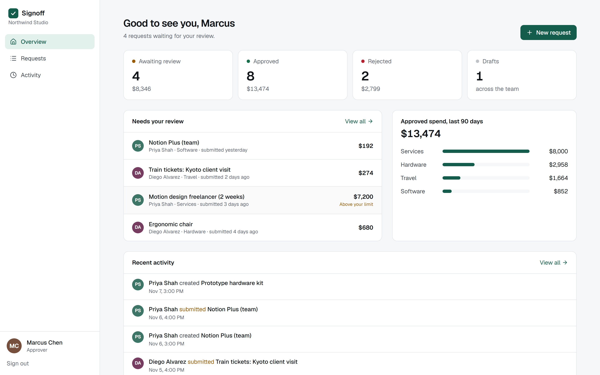
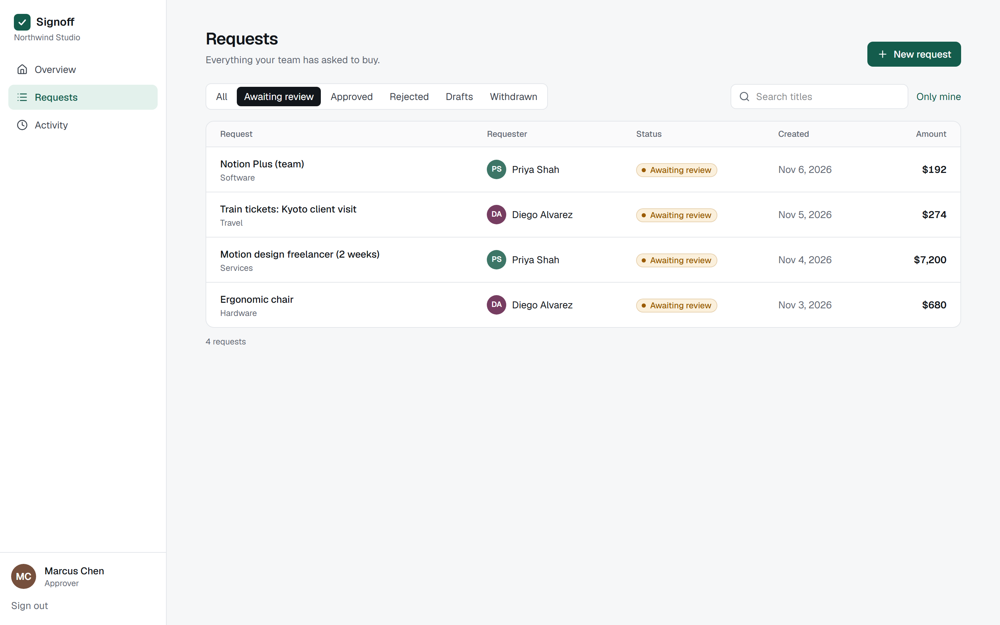
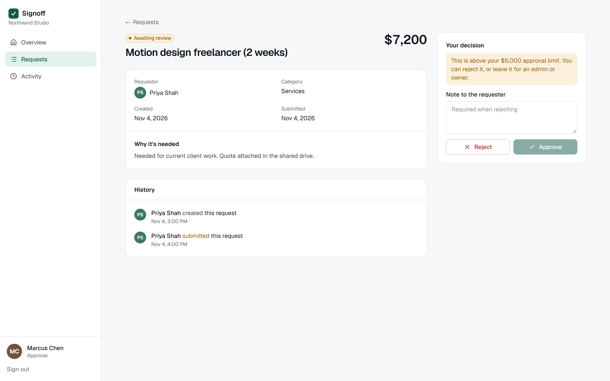
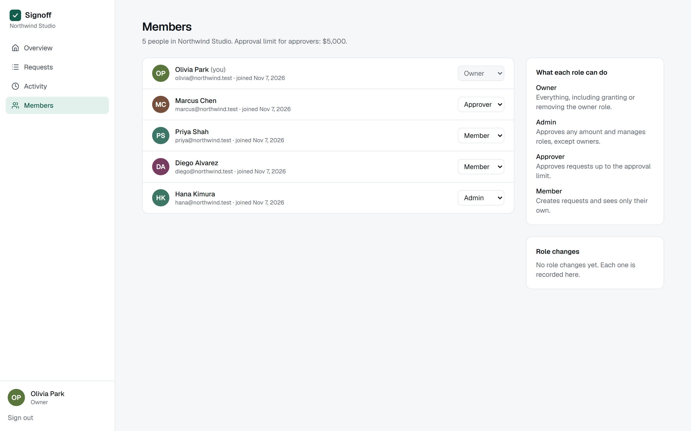
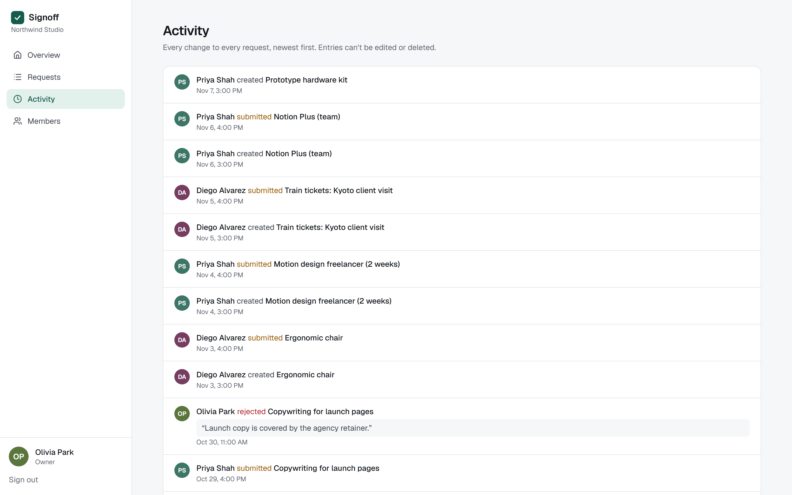

# Signoff — a multi-tenant approval workflow on Next.js + Supabase

A small, complete SaaS admin app: people in an organization file purchase requests, reviewers approve or reject them, and every status change and role change is written to an append-only log. It is a portfolio project with fictional seed data — not a client project and not deployed to production.



## What it does

| Role | Can do |
| --- | --- |
| Member | Create drafts, submit, withdraw. Sees only their own requests. |
| Approver | Everything a member can, plus approve or reject other people's requests **up to the organization's limit** ($5,000 in the seed). |
| Admin | Approves any amount. Changes roles, but can't touch owners. |
| Owner | Everything, including granting or removing the owner role. |

Rules that hold no matter which client calls the API:

- **Tenant isolation.** A user only ever sees rows from organizations they belong to (Postgres row-level security).
- **No self-approval**, including for owners.
- **Approval limit** for approvers; rejecting above the limit is allowed.
- **A rejection needs a note** for the requester.
- **Legal transitions only**: draft → submitted → approved / rejected / withdrawn. Submitted requests can't be edited.
- **Two reviewers deciding at the same moment**: exactly one wins (`select … for update` inside the decision function).
- **An organization always keeps an owner**, even when two owners demote each other at the same moment (role changes in one organization run one at a time).
- **Authors write only what a draft is made of**: title, description, category, amount and currency. Status, dates and decisions aren't writable columns at all; they change only through the functions, so a request can't carry a decision date or note that no reviewer wrote. A trigger also checks every status change, including from code that bypasses RLS.
- **Role changes are logged**: who changed whose role, from what to what. Owners and admins see the latest ones on the Members page.
- **The audit log is append-only** for users; only the database functions and triggers write to it. Deleting a draft keeps its entries and adds a `deleted` one, so nothing leaves the log; every entry keeps the request's id (`request_ref`), so a deleted draft's history still reads as one story.

## How it's built

```
Browser ── Next.js 16 (App Router, Server Components, Server Actions)
              │  user's JWT in an httpOnly cookie (@supabase/ssr)
              ▼
         Supabase API (PostgREST + Auth)
              ▼
         Postgres 16 ── RLS policies on every table
                     ── SECURITY DEFINER functions for state changes
                        (submit / withdraw / decide / set role)
                     ── trigger that rejects illegal status changes
```

- The app never uses the service-role key at request time. Every query runs as the signed-in user, so the database is the single place where access is decided — a bug in a page can hide a button, but it can't show another tenant's data.
- Writes that change state go through functions such as `decide_request`, which check role, limit, ownership and status in one transaction and write the audit entry in the same transaction.
- Schema: [`supabase/migrations/0001_signoff.sql`](supabase/migrations/0001_signoff.sql). Seed: [`supabase/seed.sql`](supabase/seed.sql).

Stack: Next.js 16.4, React 19.2, TypeScript 5.9, Tailwind CSS 4, Zod 4, `@supabase/ssr`, Postgres 16, Vitest 4, Playwright 1.63.

## Tests

| Suite | What it covers | Result (Nov 7, 2026, Windows 11, local stack) |
| --- | --- | --- |
| `npm run test:unit` | 18 tests of the sign-in redirect guard: backslashes, tabs, dot and encoded-dot segments that normalize to `//host`, and every mix of those segments four deep (14,641 paths), each checked with the same URL rules browsers use | 18 / 18 passed |
| `npm run test:db` | 28 tests against the real API with real JWTs: anonymous access (tables and functions), member isolation, cross-tenant reads and writes, writing on someone else's behalf, self-promotion, audit-log tampering, a deleted draft's log entries, writing status, dates or a decision directly, the trigger under the service role, the role-change log, approval limit, self-approval, rejection note, double decision, **concurrent decisions (5 races)**, illegal transitions, withdraw, role rules, **two owners demoting each other at once (20 races)** | 28 / 28 passed |
| `npm run test:e2e` | 12 browser tests: login redirect, wrong password, member submits → approver approves → member sees the note, rejection without a note, over-limit approve disabled (and enabled for an admin), member can't reach admin pages or another person's request, other tenant sees nothing, admin changes a role and sees it in the role history, sign-in never redirects to another site (two crafted links); on a phone viewport, no page scrolls sideways, every request card shows its status and amount on screen, and sign-out works | 12 / 12 passed |
| `npm run typecheck`, `npm run lint`, `npm run build` | — | clean |

To check that the database tests can actually fail, each rule below was broken on purpose, one at a time, and the suite was run against it. Every one was caught. `node scripts/mutations.mjs signoff` (from the repository root) does this, puts each file back and rebuilds the database afterwards; the full output, with the name of each test that caught it, is in [`docs/evidence/mutations.txt`](docs/evidence/mutations.txt).

| Deliberate weakness | Tests that failed |
| --- | --- |
| Requests readable by every signed-in user | 4 |
| Audit log writable by users | 1 |
| State-machine trigger removed | 1: the service role moved an approved request back to draft |
| Members allowed to update their own membership | 1 |
| Row-level security switched off on requests | 8 |
| The organization lock in `set_member_role` removed (how it was before the review) | 1: two owners demoted each other and the organization was left with none |
| Functions left executable by `anon` (Postgres's default `PUBLIC` grant; how it was before the review) | 1: anonymous calls to `decide_request` and `set_member_role` reached the function |
| Deleting a draft deletes its audit entries (`on delete cascade`; how it was before the third review) | 1: the draft's `created` entry was gone |
| Role changes not logged (how it was before the fifth review) | 1 |
| Every request column writable by its author (no column grants; how it was before the fifth review) | 1: a draft took a forged decision note and dates |

Code reviews by separate Claude sessions found the last five, and one more outside the database: the `?next=` check after sign-in let `/\evil.example` through, which browsers treat as another site. My first fix still let `/.//evil.example` through, because the path is normalized after the check; a sixth review found that. The check now runs on the normalized path ([`lib/safe-next.ts`](lib/safe-next.ts)). They were real, all are fixed, and the tests above now cover them. The E2E suite found two real bugs while it was being written, both fixed: an amount typed as `1,250.00` was rejected, and a failed submit cleared every field the user had typed (React 19 resets forms after an action, so the action now returns the submitted values).

## Run it locally

Requirements: Node 20+, Postgres 16, and [PostgREST 12](https://postgrest.org). Docker isn't needed: `devstack/` contains a small gateway that speaks the subset of the Supabase Auth API the app uses (password sign-in, refresh, user, sign-out) and proxies `/rest/v1` to PostgREST. With the real Supabase CLI the same migration and seed apply unchanged.

```bash
npm install                      # at the repository root
cd apps/signoff
# devstack.env: database name, ports, local-only JWT secret
# ../../devstack/local.env (not committed): POSTGREST_BIN=..., PG_BIN=... (Postgres bin, for libpq on Windows)
npm run db:reset                 # schema + seed, writes .env.local with local keys
npm run stack                    # PostgREST + auth gateway, leave running
npm run dev                      # http://localhost:4340
```

Demo accounts (password `demo-password-123`, all fictional):

| Email | Role |
| --- | --- |
| olivia@northwind.test | Owner |
| hana@northwind.test | Admin |
| marcus@northwind.test | Approver |
| priya@northwind.test, diego@northwind.test | Member |
| sam@contoso.test | Owner of a second organization |

## Known limits

- Tested against the local Supabase-compatible stack described above, not a hosted Supabase project.
- A request that RLS hides renders the "Request not found" page. Because the page has already started streaming, Next.js returns it with status 200 and a `noindex` tag rather than 404 (documented Next.js behavior).
- No email notifications, attachments, or sign-up flow; accounts come from the seed.
- Reviewers can see their teammates' drafts, so they know what is coming. Hiding drafts until they are submitted is a one-line change to the read policy, but it is a product decision, so I left it visible.
- Someone who has filed or decided a request can't be deleted: the request keeps a reference to them, so the database refuses. The two logs are ready for removal (their person columns become blank instead of the entries disappearing), but there is no account-deletion flow, and that path isn't tested.
- Built with AI assistance: most of the code was written and the checks were run with Claude Code. Every result above comes with the command that repeats it.

## Screenshots

| | |
| --- | --- |
|  |  |
|  |  |

Phone: [overview](docs/screenshots/09-mobile-dashboard.png) · [decision](docs/screenshots/10-mobile-decision.png)
